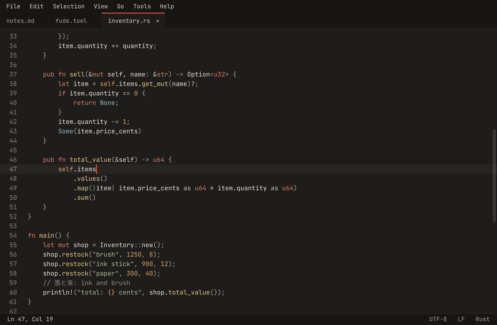
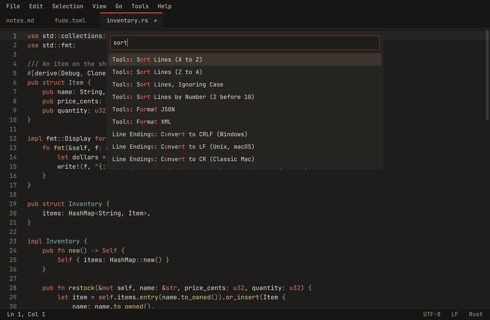
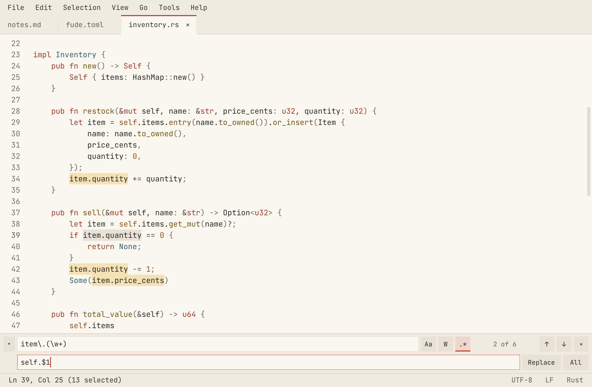
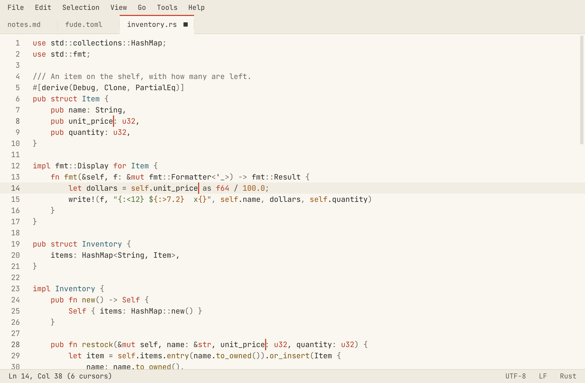

# fude 筆

**F**ast, **U**ncomplicated **D**ocument **E**ditor. *Fude* is Japanese for "brush".

A cross-platform text editor somewhere between Notepad and Notepad++: instant startup, instant response at any file size, low memory use. Windows, macOS and Linux, with BSD as a bonus.

> **Status: early.** Phases 0–5 of the [roadmap](ARCHITECTURE.md#roadmap) are done. Packaging and release are next.



<table>
  <tr>
    <td width="33%"></td>
    <td width="33%"></td>
    <td width="33%"></td>
  </tr>
  <tr>
    <td align="center"><sub>Every command in the palette</sub></td>
    <td align="center"><sub>Find and replace with regex</sub></td>
    <td align="center"><sub>Multiple cursors, light theme</sub></td>
  </tr>
</table>

- Tabs, find and replace with regex, go to line, menus and a command palette
- Syntax highlighting for 75 languages, word wrap, zoom, light and dark themes
- Multiple cursors, column selection, line commands, comments, bracket matching, auto-indent
- Large files: a 500 MB file shows in 23 ms and is editable in 0.2 s; lines of any length edit as quickly as short ones
- Hot exit: quitting never asks, and unsaved work comes back
- Text tools, built in (sort, case, Base64, JSON, hashes…) or your own programs
- Encodings, line endings and invalid bytes are kept exactly as they were
- Screen readers and other assistive technologies see the whole UI, the text of documents included, through each OS's accessibility API

## Building

Requires Rust 1.100 or later.

```sh
cargo run --release                 # welcome view
cargo run --release -- some/file.txt
```

## Using

Run from a terminal, fude opens its window in the background and gives the terminal back, like `code`. Running `fude file` while fude is open hands the file to the open window. `--wait` stays in the terminal until the window closes, for use as git's editor (`git config --global core.editor "fude --wait"`); `--new-instance` opens a separate window.

Ctrl+, opens the settings (`fude.toml`: font size, tab width, wrap, theme, hot exit, [external tools](fude/README.md#text-tools)); saving it applies it.

| | Keys (Cmd instead of Ctrl on macOS) |
|---|---|
| Select | Shift + any move, double-click a word, triple-click a line, click the gutter |
| Edit | Ctrl+Z / Ctrl+Y (or Ctrl+Shift+Z) undo and redo, Ctrl+/ comment, Shift+Alt+A block comment |
| Cursors | Ctrl+Click add or remove, Ctrl+D next occurrence, Ctrl+Shift+L all occurrences, Ctrl+Alt+↑/↓ add above or below, Shift+Alt+I one per line, Alt+drag or Shift+Alt+arrows column selection, Escape back to one |
| Lines | Alt+↑/↓ move, Ctrl+Shift+D duplicate, Ctrl+Shift+K delete, Ctrl+J join, Ctrl+Enter / Ctrl+Shift+Enter new line below / above, Tab / Shift+Tab indent / outdent, Ctrl+Shift+\ matching bracket |
| Files and tabs | Ctrl+N new tab, Ctrl+O open, Ctrl+S save, Ctrl+Shift+S save as, Ctrl+W close, Ctrl+Tab / Ctrl+1…9 switch, Ctrl+Q quit |
| Find | Ctrl+F find, Ctrl+H replace (⌘⌥F on macOS), F3 / Shift+F3 next and previous, Alt+C / W / R case, word, regex |
| Go | Ctrl+Shift+P or F1 command palette, Ctrl+G go to line (⌘L on macOS) |
| View | Alt+Z word wrap, Ctrl+= / Ctrl+- / Ctrl+0 zoom |
| Menus | F10, or Alt and a menu's first letter; right-click, Shift+F10 or the menu key for the context menu |

Every command is in the command palette with its shortcut.

## Development

```sh
cargo test --workspace
cargo clippy --workspace --all-targets
```

- [ARCHITECTURE.md](ARCHITECTURE.md): goals, budgets, how the crates fit together. Each crate has a README with its own design.
- [xtask](xtask/README.md): benchmarks, the large-file corpus, the UI test and the screenshots above (`cargo xtask`).
- [fuzz](fuzz/README.md): fuzzing the buffer.

## License

fude is licensed under the [Apache License 2.0](LICENSE).

It bundles [JetBrains Mono](https://github.com/JetBrains/JetBrainsMono), licensed under the SIL Open Font License 1.1 ([assets/fonts/jetbrains-mono/OFL.txt](assets/fonts/jetbrains-mono/OFL.txt)).
